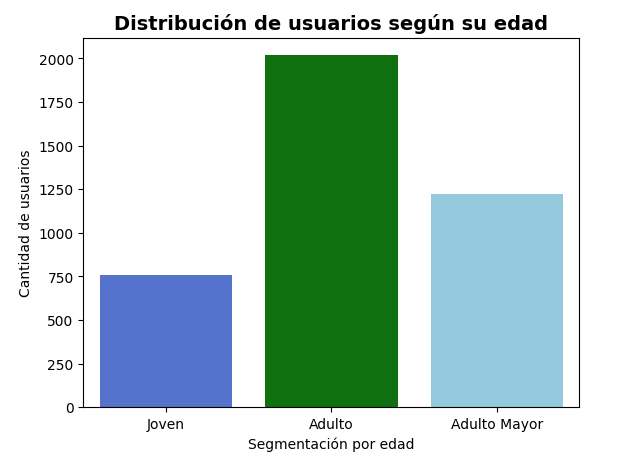
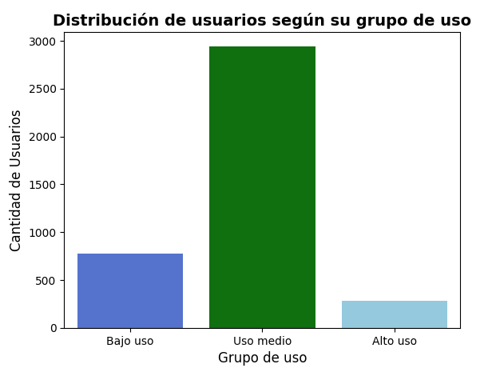
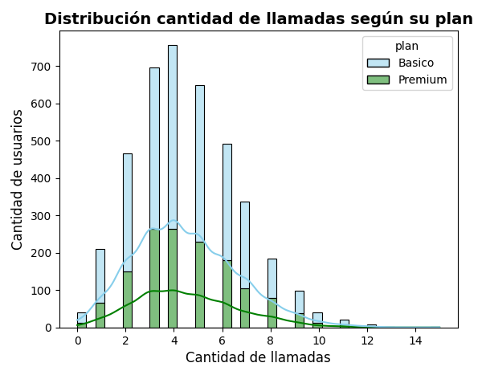
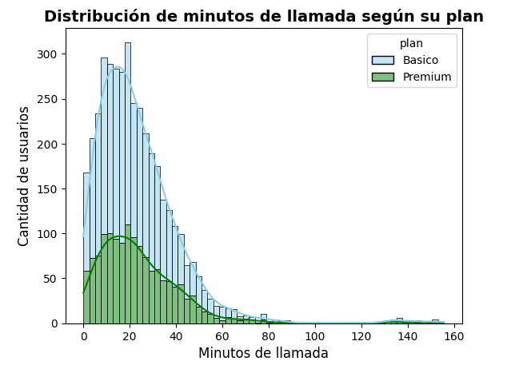

# 📊 Diagnóstico y Segmentación de Clientes: ConnectaTel

> **Autora:** Florencia Amigo Martínez  
> **Enfoque Principal:** Análisis de comportamiento de uso, segmentación de clientes y optimización comercial para el sector de telecomunicaciones en LATAM.

---

## 📑 Índice
1. [Resumen Ejecutivo & Hallazgos Principales](#1-resumen-ejecutivo--hallazgos-principales)
2. [Contexto del Negocio y Objetivos](#2-contexto-del-negocio-y-objetivos)
3. [Auditoría de Calidad y Limpieza de Datos](#3-auditoría-de-calidad-y-limpieza-de-datos)
4. [Segmentación de Clientes](#4-segmentación-de-clientes)
5. [Análisis de Patrones de Consumo y Outliers](#5-análisis-de-patrones-de-consumo-y-outliers)
6. [Recomendaciones Estratégicas y Comerciales](#6-recomendaciones-estratégicas-y-comerciales)
7. [Estructura del Repositorio](#7-estructura-del-repositorio)

---

## 1. Resumen Ejecutivo & Hallazgos Principales

Este proyecto presenta un análisis integral del comportamiento de uso real de los clientes (llamadas y mensajes) en **ConnectaTel**, operando en México y Colombia. A través de la integración de múltiples fuentes de datos, limpieza rigurosa y técnicas de segmentación, se identificaron patrones clave de consumo y oportunidades de optimización en la oferta comercial.

### 💡 Hallazgos Clave
* **Problemas de Calidad Resueltos:** Se detectaron sentinels numéricos (`-999` en edad, representando un 2% de los registros) corregidos mediante la mediana, y datos faltantes de tipo MAR (*Missing At Random*) en la duración y longitud de llamadas/mensajes que reflejan el funcionamiento normal de la red.
* **Demografía Activa (Adultos Mayores):** La base se compone de **Adultos (50.5%)**, **Adultos Mayores (30.7%)** y **Jóvenes (18.7%)**[cite: 8]. Contrario a la creencia de brecha digital, los adultos mayores mantienen un patrón de uso constante y elevado, demostrando alta lealtad y estabilidad.
* **Dominio del Uso Medio:** La gran mayoría de los clientes se concentra en la categoría de **Uso Medio (73.7%)**, seguida por **Bajo Uso (19.5%)** y **Alto Uso (6.8%)**[cite: 7].
* **Obsolescencia del SMS:** Los mensajes de texto muestran volúmenes muy bajos y un uso marginal, evidenciando que los beneficios de "SMS ilimitados" ya no representan un valor diferencial real para los usuarios.

---

## 2. Contexto del Negocio y Objetivos

**ConnectaTel** buscaba entender cómo sus clientes utilizan realmente los servicios móviles para optimizar su oferta comercial y mejorar la experiencia del usuario. Para ello, se integraron tres fuentes principales:
1. `plans.csv`: Catálogo de planes (precios, minutos y GB incluidos).
2. `users_latam.csv`: Información demográfica y de planes de los usuarios.
3. `usage.csv`: Registro histórico de actividad (llamadas, duración, mensajes y longitud).

---

## 3. Auditoría de Calidad y Limpieza de Datos

El análisis comenzó con una exhaustiva revisión de integridad para garantizar la confiabilidad de los datos:
* **Valores Nulos:** Se identificaron nulos en `city` (11.72%) y `churn_date` (88.35%, interpretados como usuarios activos). En la tabla de uso, los nulos en `duration` y `length` se mantuvieron tras comprobar que responden a un comportamiento estructural por tipo de registro (por ejemplo, un mensaje no tiene duración en minutos).
* **Sentinels e Invalidaciones:** Se localizó el valor `-999` en la columna `age` (80 filas / ~2%), el cual fue imputado utilizando la mediana. Asimismo, se filtraron fechas con años fuera de rango (como registros con fecha 2026 en bases con corte al 2024).

---

## 4. Segmentación de Clientes

### 👥 Segmentación Demográfica (Edad)
Se clasificó a los usuarios en tres grandes grupos etarios para evaluar diferencias de comportamiento frente a los planes contratados:
* **Jóvenes (<30 años):** Representan el grupo más pequeño (~18.7%), con hábitos de uso balanceados.
* **Adultos (30-59 años):** El segmento mayoritario (~50.5%), con la mayor actividad global en llamadas y mensajería.
* **Adultos Mayores (≥60 años):** El segundo grupo más grande (~30.7%), con un patrón de consumo constante y alta estabilidad.

[cite: 8]

### 📊 Segmentación por Nivel de Uso
Basado en los volúmenes combinados de llamadas y mensajes históricos por usuario, se definieron tres perfiles de consumo:
* **Bajo Uso (~19.5%):** Consumos mínimos en llamadas y mensajes (<5 interacciones).
* **Uso Medio (~73.7%):** El núcleo de la base de clientes con consumo moderado y estable.
* **Alto Uso (~6.8%):** *Heavy users* que generan un tráfico intenso en la red, especialmente en llamadas.

[cite: 7]

---

## 5. Análisis de Patrones de Consumo y Outliers

Para profundizar en el comportamiento operativo de los usuarios, se evaluó la distribución de llamadas y minutos según el tipo de plan contratado (Básico vs. Premium):

### 📞 Distribución de Llamadas por Plan
Se observa una distribución normal acampanada donde la gran mayoría de los usuarios concentra su actividad entre 2 y 4 llamadas, manteniendo un comportamiento muy similar sin importar si poseen plan Básico o Premium[cite: 9].

[cite: 9]

### ⏱️ Distribución de Minutos de Llamada por Plan
El análisis de duración de llamadas muestra un sesgo hacia la derecha, concentrando el mayor volumen de consumo en rangos de 10 a 25 minutos. Asimismo, se detectaron *outliers* de alto consumo (superando los 100-150 minutos), confirmando la existencia de un segmento de *heavy users* que saturan la red de voz[cite: 10].

[cite: 10]

---

## 6. Recomendaciones Estratégicas y Comerciales

1. **Rediseño del "Plan Premium":** Eliminar de las campañas de marketing los reclamos de "SMS ilimitados" (dado que el promedio de uso es inferior a 5 mensajes) y reenfocar el valor en bolsas de datos móviles y minutos de larga duración.
2. **Lanzamiento del "Plan Senior":** Crear un producto especializado para el segmento de **Adultos Mayores**, ofreciendo tarifas competitivas de voz, atención al cliente prioritaria y soporte o alfabetización tecnológica. Esto potenciará la lealtad en un nicho sumamente fiel y de bajo riesgo de abandono.
3. **Estrategia para Heavy Users:** Diseñar complementos o paquetes de minutos ilimitados orientados específicamente al segmento de alta demanda que sostiene el tráfico intenso de voz.

---

## 7. Estructura del Repositorio

```text
├── images/                    # Gráficos y visualizaciones del análisis
├── notebook/                  # Jupyter Notebook con el desarrollo completo en Python
└── README.md                  # Documentación ejecutiva del proyecto
